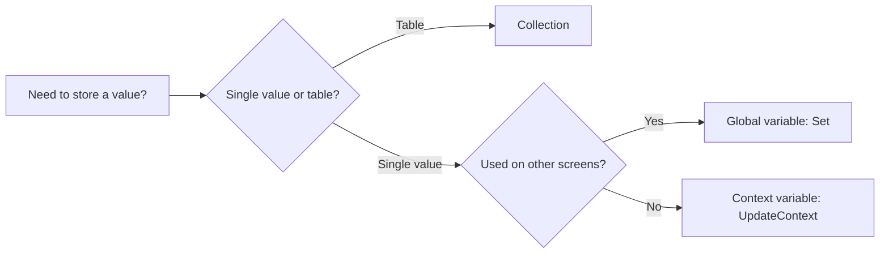

<div align="center">

# 🗂️ Collections and Variables in Power Apps

**Pick the right container for your data: global, context, or collection.**


</div>

---

## 🧠 The Three Containers

| Type | Scope | Created with | Best for |
|---|---|---|---|
| **Global variable** | Whole app | `Set` | Current user, settings, flags |
| **Context variable** | One screen | `UpdateContext` | Pop-ups, toggles, screen state |
| **Collection** | Whole app | `Collect`, `ClearCollect` | Tables of records held in memory |



## ✅ Global Variables

```powerfx
// App.OnStart or Screen.OnVisible
Set(varUser, User());
Set(varIsAdmin, !IsBlank(LookUp(Admins, Email = User().Email)))
```

## ✅ Context Variables

```powerfx
// Button.OnSelect: open a pop-up
UpdateContext({ locShowPopup: true });

// Close it
UpdateContext({ locShowPopup: false })
```

> 💡 Prefix names for clarity: `var` for global, `loc` for context, `col` for collections.

## ✅ Collections

```powerfx
// Load data into memory
ClearCollect(colOrders, Filter(Orders, Status = "Open"));

// Add a record
Collect(colCart, { Item: "Laptop", Qty: 1 });

// Update a record
Patch(colCart, LookUp(colCart, Item = "Laptop"), { Qty: 2 });

// Remove a record
Remove(colCart, LookUp(colCart, Item = "Laptop"));

// Empty it
Clear(colCart)
```

## ⚡ Performance Tips

- Load **only the columns and rows you need**. Large collections slow the app.
- Use `ClearCollect` once, not inside a gallery or timer that repeats.
- Remember the **data row limit** applies when filling a collection from a data source.
- Use **`Concurrent()`** to load several collections at the same time:

```powerfx
Concurrent(
    ClearCollect(colOrders, Orders),
    ClearCollect(colCustomers, Customers)
)
```

- Prefer **`With()`** for a temporary value used in one formula, so you avoid creating a variable at all.

## 🧹 Avoid These Mistakes

| Mistake | Better approach |
|---|---|
| Everything in `Set` variables | Use context variables for screen-only state |
| Copying a full list into a collection "just in case" | Query the data source directly |
| Long `App.OnStart` that blocks the first screen | Move loading to `Screen.OnVisible` or use `Concurrent()` |
| Names like `x` or `temp` | Use clear prefixes: `varUser`, `colOrders` |

## 📋 Checklist

- [ ] Naming prefixes used: `var`, `loc`, `col`
- [ ] Context variables used for screen-only state
- [ ] Collections hold only what the app needs offline or in memory
- [ ] `Concurrent()` used for parallel loads
- [ ] `App.OnStart` kept short

---

<div align="center">

Built by **[Bharadwaj Vemula](https://github.com/bharadwaj-vemula)** · Microsoft Power Platform Developer

</div>
